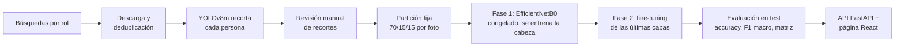
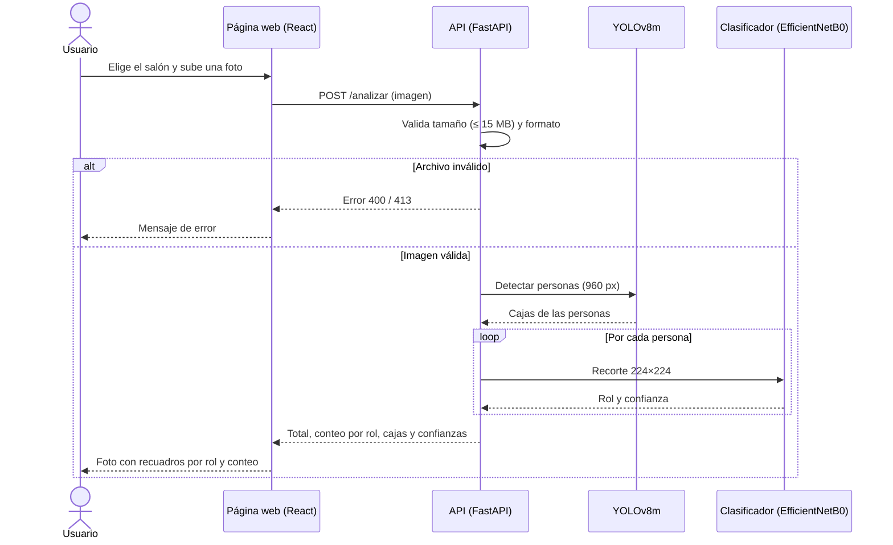

# SmartClassrooms Roles: conteo de personas por rol en un salón

**Autores:** [Nombre completo 1], [Nombre completo 2]
**Curso:** [Nombre y código del curso]
**Fecha:** [Fecha de entrega]

## 1. Introducción

Para gestionar un salón (aforo, asistencia, seguridad) no basta con saber cuántas personas hay: también importa quiénes son. Un estudiante, una persona de aseo y un guardia de seguridad cumplen funciones distintas, pero las cámaras y los contadores comunes solo cuentan "personas", y revisar fotos a mano no escala.

Este proyecto sube una foto de un salón y devuelve cada persona remarcada con su rol (estudiante, aseo o seguridad) y el conteo por rol. Combina un detector preentrenado (YOLOv8m) con un clasificador propio entrenado por transfer learning (EfficientNetB0), y lo expone en una página web.

## 2. Objetivo

**General:** detectar a las personas en una foto de un salón y clasificar automáticamente su rol.

**Específicos:**
1. Construir un dataset limpio de recortes de personas para tres roles, con al menos 200 recortes por clase.
2. Entrenar un clasificador de roles con F1 macro ≥ 0,90 en un conjunto de prueba que el modelo nunca vio.
3. Desplegar el sistema en una página web que, a partir de una foto, muestre a cada persona remarcada con su rol y el conteo por rol.

## 3. Descripción de los datos

| | Estudiante | Aseo | Seguridad | Total |
|---|---|---|---|---|
| Fotos descargadas (`escenas/`) | 384 | 374 | 310 | 1.068 |
| Recortes revisados (`recortes/`) | 304 | 237 | 204 | 745 |
| Train / validation / test | 215 / 45 / 44 | 166 / 35 / 36 | 143 / 30 / 31 | 524 / 110 / 111 |

- **Fuente:** imágenes públicas de internet obtenidas con búsquedas en español e inglés por rol (`SEARCHES` en `roles_salon.py`, buscador DuckDuckGo). Para estudiantes se agregaron búsquedas de universitarios de pie y con ropa oscura (ver Resultados). A estas se sumaron 5 fotos de guardias elegidas a mano y una foto de un salón real de EAFIT.
- **Formato:** JPG RGB. Cada recorte contiene a una persona y se redimensiona a 224×224. La clase es el nombre de la carpeta.
- **Preprocesamiento:**
  1. YOLOv8m detecta a las personas de cada foto y las recorta con un margen del 8 %.
  2. Se descartan las personas muy pequeñas (menos de 96 px de lado) y las fotos de aseo o seguridad con más de 2 personas, porque no se sabe cuál tiene el rol.
  3. Se eliminan las fotos duplicadas por hash.
  4. Todos los recortes se revisaron a mano. Se borraron dibujos, prendas o herramientas sin persona, recortes donde el rol no se distingue, personas que no correspondían a su clase y niños de colegio, porque el sistema está pensado para salones universitarios.
- **Partición:** 70 / 15 / 15 de los recortes de cada clase. Se reparte por foto de origen, para que los recortes de una misma foto no queden a la vez en train y en test. Las fotos se ordenan por un hash fijo de su nombre y los grupos se llenan en ese orden, así que agregar o borrar fotos solo mueve las que quedan en el límite y el test se mantiene entre entrenamientos. Excepción: algunas fotos van siempre a train para que el modelo aprenda de ellas. Son las de salones reales, que son escasas (un salón de EAFIT con 7 estudiantes, fotografiados con su permiso, y otro salón con un estudiante de buzo negro), y 7 fotos de guardias elegidas a mano. Se listan en `data_roles/solo_train.txt`. No inflan la nota, porque simplemente no se usan en el test.
- **Limitaciones y sesgos:**
  - Son fotos de internet, a menudo de stock, y no de salones reales. Los uniformes de aseo y seguridad suelen verse muy marcados.
  - La clase estudiante estaba sesgada hacia niños de colegio sentados, mientras que aseo y seguridad aparecen casi siempre de pie y de cuerpo entero. Se corrigió en parte (ver Resultados), pero la pose sigue influyendo en la predicción.
  - No se midió el desempeño por género, edad o tono de piel.
- **Licencia:** las imágenes pertenecen a terceros. Se usan solo con fines educativos y por eso el dataset no se incluye en el repositorio.

## 4. Metodología


*Figura 1. Pipeline desde la obtención de datos hasta el despliegue.*

1. **Detección:** YOLOv8m preentrenado en COCO, usando solo la clase `person`. En producción analiza la foto a 960 px: a 640 px se perdían estudiantes del fondo y a 1280 px aparecían personas inexistentes.
2. **Clasificación:** EfficientNetB0 preentrenado en ImageNet, con una cabeza nueva (pooling, dropout de 0,3 y softmax de 3 clases). Se eligió por su buena precisión con pocos parámetros, lo que lo hace adecuado para un dataset pequeño y para inferencia en CPU.
3. **Entrenamiento en dos fases:**
   - **Fase 1:** la base se congela y solo se entrena la cabeza (Adam, LR 1e-3, hasta 15 épocas). Este modelo es la **línea base**.
   - **Fase 2:** fine-tuning de las últimas 20 capas con BatchNorm congelada (LR 1e-5, hasta 8 épocas).
   - En ambas fases hay early stopping (paciencia 3) y el modelo final se elige por `val_loss` en validación, nunca en test.
4. **Desbalance:** se compensa con `class_weight="balanced"`.
5. **Aumentos:** volteo horizontal, rotación, zoom, brillo y contraste leves. No se altera el tono, porque el color del uniforme es una señal útil.
6. **Métricas:**
   - **Accuracy**, con su intervalo de confianza del 95 % calculado por bootstrap, porque el test es pequeño.
   - **F1 macro:** da el mismo peso a cada clase, así que no favorece a la clase más grande.
   - **Matriz de confusión.**
7. **Inferencia:** si la confianza del clasificador baja de 0,60, la persona se cuenta como "indeterminado" y sigue sumando al total.

## 5. Diagrama de interacción

En producción no se guarda ninguna foto: la imagen vive solo en memoria mientras dura la petición.


*Figura 2. Secuencia de una consulta en producción.*

## 6. Resultados

Todos los resultados son del conjunto de test: 111 recortes de fotos que el modelo no vio al entrenar (44 de estudiante, de los cuales 20 son universitarios; 36 de aseo y 31 de seguridad).

| Modelo | Accuracy (IC 95 %) | F1 macro |
|---|---|---|
| Clase mayoritaria (siempre "estudiante") | 0,396 | 0,189 |
| Línea base: EfficientNetB0 congelado | 0,892 (0,829–0,946) | 0,893 |
| **Fine-tuning (modelo final)** | **0,919 (0,865–0,964)** | **0,919** |

| Clase | Precision | Recall | F1 |
|---|---|---|---|
| Estudiante | 0,974 | 0,864 | 0,916 |
| Aseo | 0,917 | 0,917 | 0,917 |
| Seguridad | 0,861 | 1,000 | 0,925 |


*Figura 3. Matriz de confusión del modelo final en test.*


*Figura 4. Accuracy y pérdida en train y validación durante el fine-tuning.*

**Análisis:**
- **Lo que más pesó fue la calidad de los datos, no el modelo.** Cambios principales al dataset, en orden:

  | Cambio | Problema que resolvía |
  |---|---|
  | Más fotos de aseo y seguridad | Clases con la mitad de recortes que estudiante |
  | Revisión manual de cada recorte | Etiquetas erróneas y recortes sin persona o sin rol visible |
  | Partición fija 70/15/15 por recortes | El test cambiaba en cada entrenamiento y las notas no se podían comparar |
  | Quitar niños de colegio y agregar universitarios de pie y con ropa oscura | El modelo había aprendido que "de pie, de cuerpo entero o con ropa oscura" significa personal, y en un salón real confundía a estudiantes que exponían frente al tablero con aseo |

  El modelo original obtuvo 0,797 de accuracy sobre otro test (74 recortes), así que esa comparación es solo orientativa. Con un test casi igual al actual, agregar 20 universitarios más y corregir dos etiquetas de seguridad subió la accuracy de 0,864 a 0,919.
- **El fine-tuning aporta una mejora moderada.** Sube la accuracy de 0,892 a 0,919 (3 recortes más) y baja la `val_loss` de 0,157 a 0,134, pero los intervalos de confianza se solapan.
- **Errores que quedan:** son 9 de 111.
  - **Estudiantes llamados personal:** 6 de 44, tres como aseo y tres como seguridad. Casi siempre son personas de pie o de espaldas con chaqueta oscura.
  - **Aseo sin uniforme:** 3 de 36. Son personas limpiando con ropa de calle, que solo se distinguen por lo que hacen.
  - **Seguridad** encuentra a todos los guardias (31 de 31), pero 5 de las 36 veces que dice "seguridad" se equivoca.
- **Limitaciones:**
  - El test es pequeño: con unos 35 recortes por clase, un error cambia el recall en unos 3 puntos. Una validación cruzada (k-fold) daría una estimación más estable.
  - Los datos vienen de internet y no de salones reales, así que el desempeño en un salón real puede ser menor.
  - El conteo completo, con detección más clasificación, no se evaluó en fotos reales contadas a mano.
  - La alternativa de entrenar YOLOv8m directamente con los tres roles (`etiquetar`, `dividir-yolo` y `comparar` en `roles_salon.py`) quedó implementada pero no se entrenó.

## 7. Reproducibilidad

**Requisitos:** Python 3.12, Node 20 o superior y pnpm. La GPU es opcional: el clasificador entrena en CPU en unos 5 minutos.

```bash
# API (la primera vez descarga yolov8m.pt)
cd vision-service
python3.12 -m venv .venv && source .venv/bin/activate   # Windows: py -3.12 -m venv .venv; .\.venv\Scripts\Activate.ps1
pip install -r requirements.txt
uvicorn app:app --port 8000

# Página (otra terminal), luego abrir http://localhost:5173
cd frontend && pnpm install && pnpm dev
```

**Reentrenar el clasificador**, dentro de `vision-service` y con el entorno activado:

```bash
python roles_salon.py descargar      # fotos por clase (--clases para elegir)
python roles_salon.py recortar       # no lo repitas: borra tu revisión. Para fotos nuevas usa --solo-nuevas
#   >>> revisa a mano data_roles/recortes/ <<<
python roles_salon.py dividir        # partición fija 70/15/15
python roles_salon.py entrenar       # fases 1 y 2, métricas y gráficas en data_roles/modelo/
```

**Pruebas:** `python test_roles_salon.py`, `python test_api_errores.py` y `python test_app.py` (este último usa los modelos reales) en `vision-service`, y `pnpm test` en `frontend`. GitHub Actions corre las rápidas en cada push.

**Estructura del repositorio:**

```text
├── frontend/                  Página React + Vite (subir foto y ver resultados)
│   └── src/app/App.tsx
├── vision-service/
│   ├── app.py                 API FastAPI: POST /analizar
│   ├── roles_salon.py         Pipeline completo: descargar, recortar, dividir, entrenar, contar
│   ├── test_*.py              Pruebas
│   ├── fotos_prueba/          Fotos de ejemplo
│   └── data_roles/modelo/     Clasificador entrenado, clases, matrices y curvas
└── .github/workflows/         Integración continua
```
