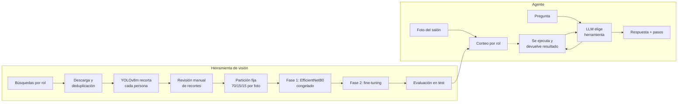
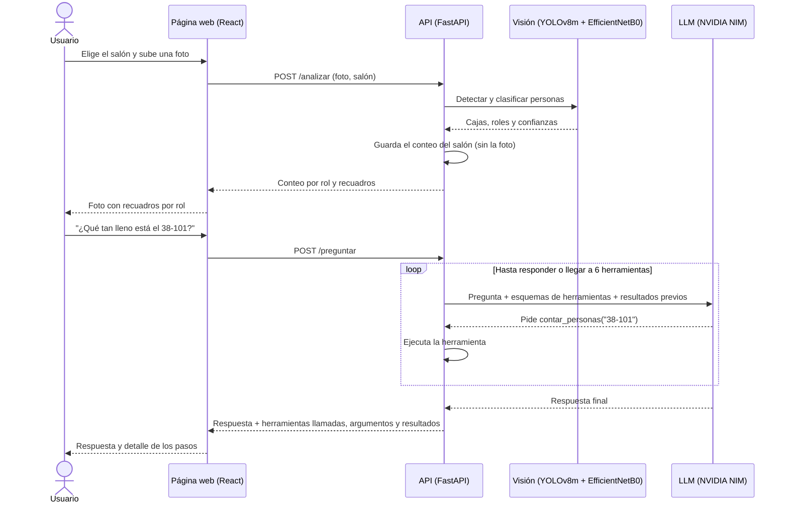
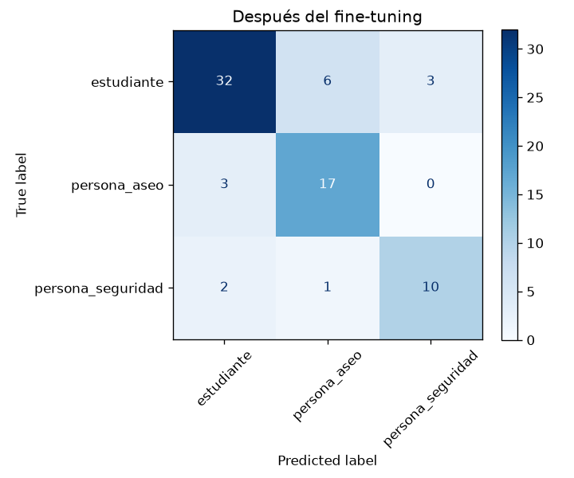
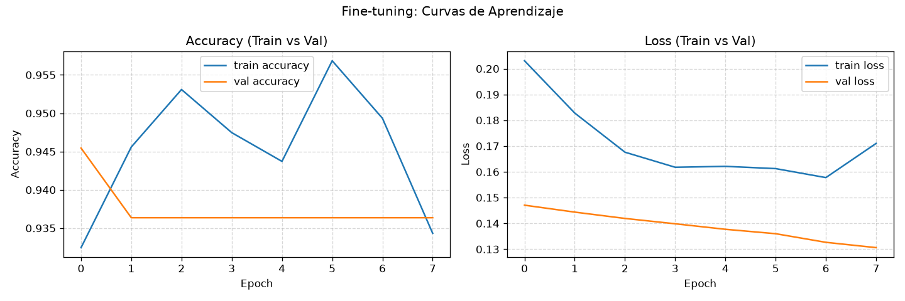

# SmartClassrooms Roles: agente de ocupación de salones

**Integrantes:** Jerónimo Contreras, Cristian Bolaños, Miguel Bernal
**Curso:** SI3003 Inteligencia Artificial, Universidad EAFIT
**Fecha:** 13 de noviembre de 2026
**Opción elegida:** B, agente con herramientas

## 1. Introducción

Para gestionar un salón (aforo, asistencia, seguridad) no basta con saber cuántas personas hay: también importa quiénes son. Un estudiante, una persona de aseo y un guardia de seguridad cumplen funciones distintas, pero las cámaras y los contadores comunes solo cuentan "personas", y revisar fotos a mano no escala.

Este proyecto es un **agente con herramientas**. Un modelo de lenguaje responde preguntas en español sobre la ocupación de tres salones de EAFIT, llamando a herramientas que consultan los salones, cuentan las personas por rol en la última foto de cada salón y calculan la ocupación. El conteo lo hace un sistema de visión propio: YOLOv8m detecta a cada persona y un clasificador EfficientNetB0, entrenado por transfer learning, decide si es estudiante, persona de aseo o de seguridad.

**Definición del problema:**
1. **Qué problema y para quién:** la administración de un edificio o el personal de bienestar quieren saber, sin revisar fotos a mano, cuánta gente hay en cada salón, si hay personal de aseo o de seguridad y si se supera la capacidad.
2. **Qué preguntas atiende:**
   - ¿Cuántos estudiantes hay en el 38-101?
   - ¿Hay personal de aseo en el 38-102?
   - ¿Qué porcentaje de ocupación tiene un salón?
   - ¿Qué salón está más lleno?
   - ¿Qué salones tienen foto analizada?
3. **Por qué un agente y no RAG:** las respuestas no están en documentos. Salen de **datos que cambian** (la última foto de cada salón) y de **cálculos** (la ocupación). Un RAG solo recuperaría texto fijo. El agente decide qué herramienta usar y las encadena: por ejemplo, contar, consultar la capacidad y calcular.
4. **Fuera del alcance:**
   - No identifica personas ni guarda fotos: solo cuenta roles.
   - No hace seguimiento en video ni historial: usa la última foto procesada de cada salón.
   - No distingue profesores; el clasificador conoce solo tres roles.
   - Solo cubre tres salones de ejemplo.

## 2. Objetivo

**General:** responder en lenguaje natural preguntas sobre la ocupación y los roles de las personas en un salón, a partir de una foto.

**Específicos:**
1. Entrenar un clasificador de roles (estudiante, aseo, seguridad) con F1 macro ≥ 0,90 en un conjunto de prueba que el modelo nunca vio.
2. Construir un agente con al menos tres herramientas, que las seleccione y encadene según la pregunta y que tenga un límite de llamadas.
3. Validar el agente con cinco casos de prueba documentados: tres habituales, uno que exija varias herramientas y uno límite.

## 3. Descripción de los datos

Los datos son los del **clasificador de roles**, la herramienta de visión del agente. El agente no se entrena: usa un LLM preentrenado.

| | Estudiante | Aseo | Seguridad | Total |
|---|---|---|---|---|
| Fotos descargadas (`escenas/`) | 387 | 374 | 317 | 1.078 |
| Recortes revisados (`recortes/`) | 306 | 237 | 211 | 754 |
| Train / validation / test | 217 / 45 / 44 | 166 / 35 / 36 | 150 / 30 / 31 | 533 / 110 / 111 |

- **Fuente:** imágenes públicas de internet obtenidas con búsquedas en español e inglés por rol (`SEARCHES` en `roles_salon.py`, buscador DuckDuckGo). Para estudiantes se agregaron búsquedas de universitarios de pie y con ropa oscura (ver Resultados). A estas se sumaron 7 fotos de guardias elegidas a mano y fotos de salones reales.
- **Formato:** JPG RGB. Cada recorte contiene a una persona y se redimensiona a 224×224. La clase es el nombre de la carpeta.
- **Preprocesamiento:**
  1. YOLOv8m detecta a las personas de cada foto y las recorta con un margen del 8 %.
  2. Se descartan las personas muy pequeñas (menos de 96 px de lado) y las fotos de aseo o seguridad con más de 2 personas, porque no se sabe cuál tiene el rol.
  3. Se eliminan las fotos duplicadas por hash.
  4. Todos los recortes se revisaron a mano. Se borraron dibujos, prendas o herramientas sin persona, recortes donde el rol no se distingue, personas que no correspondían a su clase y niños de colegio, porque el sistema está pensado para salones universitarios.
- **Partición:** 70 / 15 / 15 de los recortes de cada clase. Se reparte por foto de origen, para que los recortes de una misma foto no queden a la vez en train y en test. Las fotos se ordenan por un hash fijo de su nombre y los grupos se llenan en ese orden, así que agregar o borrar fotos solo mueve las que quedan en el límite y el test se mantiene entre entrenamientos. Excepción: algunas fotos van siempre a train para que el modelo aprenda de ellas. Son las de salones reales, que son escasas (un salón de EAFIT con 7 estudiantes, fotografiados con su permiso, y otro salón con un estudiante de buzo negro), y 7 fotos de guardias elegidas a mano. Se listan en `data_roles/solo_train.txt`. No inflan la nota, porque simplemente no se usan en el test.
- **Limitaciones y sesgos:**
  - Son fotos de internet, a menudo de stock, y no de salones reales. Los uniformes de aseo y seguridad suelen verse muy marcados.
  - La clase estudiante estaba sesgada hacia niños de colegio sentados, mientras que aseo y seguridad aparecen casi siempre de pie y de cuerpo entero. Se corrigió en parte (ver Resultados), pero la pose sigue influyendo en la predicción.
  - No se midió el desempeño por género, edad o tono de piel.
- **Licencia:** las imágenes pertenecen a terceros. Se usan solo con fines educativos y por eso el dataset no se incluye en el repositorio.

## 4. Metodología


*Figura 1. Pipeline: entrenamiento de la herramienta de visión y funcionamiento del agente.*

### 4.1 Agente

| Herramienta | Argumentos | Qué devuelve |
|---|---|---|
| `listar_salones` | ninguno | Id, nombre, capacidad y si el salón tiene foto analizada |
| `contar_personas` | `salon` | Total y conteo por rol de la última foto del salón (estudiante, aseo, seguridad, indeterminado), y la hora del análisis. Si el salón no existe o no tiene foto, devuelve un error explicativo |
| `calcular_ocupacion` | `salon` | Personas, capacidad, porcentaje de ocupación, cupos libres y si se supera la capacidad. Toma el conteo del último análisis y la capacidad de la lista de salones, así que el modelo no pasa números que pueda equivocar |

- **Modelo:** `nvidia/nemotron-3.5-super-vl-120b-a12b` en NVIDIA NIM, con `temperature=0` para que las respuestas sean repetibles. Se usa por la API compatible con OpenAI, así que se puede cambiar por otro proveedor con las variables `AGENTE_BASE_URL` y `AGENTE_MODELO`.
- **Ciclo (`agente.py`, adaptado del loop de Lecture11):**
  1. El LLM recibe la pregunta y los esquemas de las herramientas.
  2. Si pide una herramienta, el código la ejecuta y le devuelve el resultado como mensaje `tool`.
  3. Se repite hasta que responde sin pedir herramientas.
  4. Los errores de una herramienta (salón inexistente, argumentos inválidos) vuelven al modelo como texto, para que pueda explicarlos.
- **Límite:** como máximo **6 llamadas a herramientas por pregunta**. Al alcanzarlo, se le quitan las herramientas al modelo, que debe responder con lo que ya obtuvo. La respuesta empieza con "(Se alcanzó el límite de 6 consultas a herramientas.)" y la API devuelve `limite_alcanzado: true`.
- **Instrucciones del sistema:**
  - Usar siempre las herramientas y no inventar conteos.
  - Calcular la ocupación con `calcular_ocupacion` y no a mano.
  - Decir cuándo falta la foto de un salón.
  - No asignar rol a las personas "indeterminadas".
  - Rechazar preguntas fuera del tema.
- **Privacidad:** el LLM nunca ve la foto. Solo recibe los números que devuelven las herramientas. Al quitar la foto de un salón en la página, también se borra su conteo (`DELETE /analisis/{salon}`), y el agente vuelve a responder que ese salón no tiene foto.

### 4.2 Herramienta de visión

1. **Detección:** YOLOv8m preentrenado en COCO, usando solo la clase `person`. En producción analiza la foto a 960 px: a 640 px se perdían estudiantes del fondo y a 1280 px aparecían personas inexistentes.
2. **Clasificación:** EfficientNetB0 preentrenado en ImageNet, con una cabeza nueva (pooling, dropout de 0,3 y softmax de 3 clases). Se eligió por su buena precisión con pocos parámetros, lo que lo hace adecuado para un dataset pequeño y para inferencia en CPU.
3. **Entrenamiento en dos fases:**
   - **Fase 1:** la base se congela y solo se entrena la cabeza (Adam, LR 1e-3, hasta 15 épocas). Este modelo es la **línea base**.
   - **Fase 2:** fine-tuning de las últimas 20 capas con BatchNorm congelada (LR 1e-5, hasta 8 épocas).
   - En ambas fases hay early stopping (paciencia 3) y el modelo final se elige por `val_loss` en validación, nunca en test.
4. **Desbalance:** se compensa con `class_weight="balanced"`.
5. **Aumentos:** volteo horizontal, rotación, zoom, brillo y contraste leves. No se altera el tono, porque el color del uniforme es una señal útil.
6. **Métricas:**
   - **Accuracy**, con su intervalo de confianza del 95 % calculado por bootstrap, porque el test es pequeño.
   - **F1 macro:** da el mismo peso a cada clase, así que no favorece a la clase más grande.
   - **Matriz de confusión.**
7. **Inferencia:** si la confianza del clasificador baja de 0,60, la persona se cuenta como "indeterminado" y sigue sumando al total.

## 5. Diagrama de interacción

En producción no se guarda ninguna foto: la imagen vive solo en memoria mientras dura la petición, y para cada salón solo se conserva el último conteo.


*Figura 2. Secuencia de uso: analizar la foto de un salón y preguntar al agente.*

## 6. Resultados

### 6.1 Casos de prueba del agente

Escenario fijo:
- **38-101:** `fotos_prueba/salon_aseo.webp`. La visión detecta 16 personas: 15 estudiantes y 1 de aseo.
- **38-102:** `foto_salon.jpg`. Detecta 5 personas: 4 estudiantes y 1 de aseo.
- **38-201:** sin foto.

Se ejecutan con `python casos_agente.py`, que deja el detalle completo (herramientas, argumentos, resultados y respuesta) en `vision-service/casos_agente_salida.md`, sin tocar `casos_agente.md`, donde están las valoraciones hechas a mano. La evaluación es manual.

| # | Tipo | Pregunta | Resultado esperado | Herramientas llamadas | Respuesta obtenida | Valoración |
|---|---|---|---|---|---|---|
| 1 | Habitual | ¿Cuántos estudiantes hay en el 38-101? | `contar_personas("38-101")`, responde 15 | `contar_personas("38-101")` | "Hay 15 estudiantes en el salón 38-101." | ✅ Una sola herramienta, la adecuada. La respuesta coincide con el conteo |
| 2 | Habitual | ¿Hay personal de aseo en el aula 38-102? | `contar_personas("38-102")`, responde que sí, 1 persona | `contar_personas("38-102")` | "Sí, hay una persona con rol de personal de aseo en el aula 38-102." | ✅ Correcta, con una sola herramienta. Interpretó bien "aula 38-102" como el id del salón |
| 3 | Habitual | ¿Qué porcentaje de ocupación tiene el 38-101? | `calcular_ocupacion("38-101")`: 16 personas de 40, responde 40 % | `calcular_ocupacion("38-101")` | "El salón 38-101 tiene una ocupación del 40 por ciento. Hay 16 personas de una capacidad de 40, con 24 cupos libres y no supera su capacidad." | ✅ Una sola llamada: la herramienta tomó el conteo y la capacidad, y el modelo no hizo la cuenta |
| 4 | Varias herramientas | De los salones con foto analizada, ¿cuál está más lleno respecto a su capacidad? | Calcula 40 % en el 38-101 y 14,3 % en el 38-102, responde que el 38-101 | `listar_salones()` → `calcular_ocupacion` ×2 | "El salón más lleno respecto a su capacidad es el 38-101, con un 40 por ciento de ocupación. El salón 38-102 tiene un 14.3 por ciento." | ✅ 3 llamadas. Usó `listar_salones` para saber qué salones tienen foto e ignoró el 38-201 |
| 5 | Límite | ¿Cuántos guardias de seguridad hay en el 38-201? | El salón no tiene foto: debe decirlo sin inventar un número | `contar_personas("38-201")` → error "no tiene ninguna foto analizada" | "El salón 38-201 no tiene ninguna foto analizada todavía, por lo que no puedo decirte cuántos guardias de seguridad hay. Falta subir y procesar una foto en la página…" | ✅ No inventó un número y explicó qué falta |

Los cinco casos funcionaron con el modelo `nvidia/nemotron-3.5-super-vl-120b-a12b`. El detalle completo, con los resultados de cada herramienta, está en `vision-service/casos_agente.md`.

**Caso más difícil: una foto real, fuera del dataset.** Se registró como 38-201 una foto de un evento real en EAFIT (`fotos_prueba/eafit_evento.jpg`, publicada con el consentimiento de las personas) y se preguntó *"¿Cuántas personas hay en el 38-201 y hay alguien de aseo o seguridad?"*.
- El agente llamó a `contar_personas("38-201")` y respondió: *"En el salón 38-201 hay 7 personas, todas estudiantes. No hay personal de aseo ni de seguridad."*
- **El agente hizo bien su parte:** usó la herramienta adecuada y repitió fielmente su resultado.
- **La respuesta es incorrecta:**
  - A simple vista hay unas 9 personas: YOLO no detectó a dos que estaban tapadas por las de adelante.
  - La expositora quedó contada como "estudiante", porque el clasificador no tiene una clase para profesores o expositores.

**Limitación observada:** el agente es tan bueno como su herramienta de visión. Como no ve la foto, repite sus errores sin dudar: subconteo por oclusión y roles que no existen en el modelo.

**Segunda limitación observada, y corregida: el límite de llamadas.** En la primera versión, `calcular_ocupacion` recibía `personas` y `capacidad`, así que el modelo tenía que pedir antes el conteo y la capacidad. *"Compara la ocupación del 38-101, el 38-102 y el 38-201"* necesitaba unas 7 llamadas y chocaba con el límite de 6: el agente respondía a medias. Además, la capacidad la ponía el modelo, que podía equivocarla. Ahora `calcular_ocupacion` recibe solo el salón y toma los dos números de los datos. La misma pregunta usa 3 llamadas, una por salón, y responde completo: 40 %, 14,3 % y 15,6 %.

**Posibles mejoras:**
1. Que `contar_personas` devuelva también cuántas personas quedaron con baja confianza, para que el agente pueda advertir que el conteo es aproximado.
2. Una cuarta clase "profesor/expositor".
3. Bajar el umbral de confianza de YOLO solo para personas parcialmente tapadas.

### 6.2 Herramienta de visión

Todos los resultados son del conjunto de test: 111 recortes de fotos que el modelo no vio al entrenar (44 de estudiante, de los cuales 20 son universitarios; 36 de aseo y 31 de seguridad).

| Modelo | Accuracy (IC 95 %) | F1 macro |
|---|---|---|
| Clase mayoritaria (siempre "estudiante") | 0,396 | 0,189 |
| Línea base: EfficientNetB0 congelado | 0,901 | 0,901 |
| **Fine-tuning (modelo final)** | **0,910 (0,856–0,964)** | **0,911** |

| Clase | Precision | Recall | F1 |
|---|---|---|---|
| Estudiante | 0,974 | 0,841 | 0,902 |
| Aseo | 0,892 | 0,917 | 0,904 |
| Seguridad | 0,861 | 1,000 | 0,925 |

El modelo final se midió otra vez con `clasificador_roles.keras` sobre este test, y coincide con su matriz de confusión guardada (Figura 3). La línea base sale de `confusion_antes.png`; sus pesos no se suben al repositorio.


*Figura 3. Matriz de confusión del modelo final en test.*


*Figura 4. Accuracy y pérdida en train y validación durante el fine-tuning.*

**Análisis:**
- **Lo que más pesó fue la calidad de los datos, no el modelo.** Cambios principales al dataset, en orden:

  | Cambio | Problema que resolvía |
  |---|---|
  | Más fotos de aseo y seguridad | Clases con la mitad de recortes que estudiante |
  | Revisión manual de cada recorte | Etiquetas erróneas y recortes sin persona o sin rol visible |
  | Partición fija 70/15/15 por recortes | El test cambiaba en cada entrenamiento y las notas no se podían comparar |
  | Quitar niños de colegio y agregar universitarios de pie y con ropa oscura | El modelo había aprendido que "de pie, de cuerpo entero o con ropa oscura" significa personal, y en un salón real confundía a estudiantes que exponían frente al tablero con aseo |

  El modelo original obtuvo 0,797 de accuracy sobre otro test (74 recortes), así que esa comparación es solo orientativa.
- **El fine-tuning aporta poco.** Sube la accuracy de 0,901 a 0,910, un recorte más. En las curvas, la `val_loss` baja de ≈ 0,15 al final de la fase 1 a ≈ 0,13 al final de la fase 2.
- **Errores que quedan:** son 10 de 111.
  - **Estudiantes llamados personal:** 7 de 44, cuatro como aseo y tres como seguridad. Casi siempre son personas de pie o de espaldas con chaqueta oscura.
  - **Aseo confundido:** 3 de 36, dos como seguridad y uno como estudiante. Son sobre todo personas limpiando con ropa de calle, que solo se distinguen por lo que hacen.
  - **Seguridad** encuentra a todos los guardias (31 de 31), pero 5 de las 36 veces que dice "seguridad" se equivoca.
- **Umbral de 0,60:** 102 de los 111 recortes lo superan, y en ellos la accuracy es 0,951. Los otros 9 se contarían como "indeterminado".
- **Limitaciones:**
  - El test es pequeño: con unos 35 recortes por clase, un error cambia el recall en unos 3 puntos. Una validación cruzada (k-fold) daría una estimación más estable.
  - Los datos vienen de internet y no de salones reales, así que el desempeño en un salón real puede ser menor.
  - El conteo completo, con detección más clasificación, no se evaluó en fotos reales contadas a mano.
  - Una alternativa sería entrenar YOLOv8m directamente con los tres roles, para detectar y clasificar en un solo paso. No se hizo.

## 7. Reproducibilidad

**Requisitos:** Python 3.12, Node 20 o superior y pnpm. La GPU es opcional: el clasificador entrena en CPU en unos 5 minutos.

**Clave del modelo de lenguaje (privada, nunca en el repositorio):** crea una clave gratuita en [build.nvidia.com](https://build.nvidia.com). Empieza por `nvapi-`. Después, en `vision-service`:

```bash
cp .env.example .env    # y pon tu clave en NVIDIA_API_KEY; .env está en .gitignore
```

También sirve exportarla como variable de entorno (`export NVIDIA_API_KEY=nvapi-...`). Sin clave, la página y el conteo funcionan igual; solo el asistente responde "Falta la clave del modelo".

```bash
# API (la primera vez descarga yolov8m.pt)
cd vision-service
python3.12 -m venv .venv && source .venv/bin/activate   # Windows: py -3.12 -m venv .venv; .\.venv\Scripts\Activate.ps1
pip install -r requirements.txt
uvicorn app:app --port 8000

# Página (otra terminal), luego abrir http://localhost:5173
cd frontend && pnpm install && pnpm dev
```

En la página, elige un salón, sube la foto, pulsa **Procesar** y pregunta en **Asistente de ocupación**. Debajo de cada respuesta se ven las herramientas usadas, con sus argumentos y resultados.

**Cuaderno explicativo:** `vision-service/explicacion_proyecto.ipynb` explica, con ejemplos que se ejecutan:
- la arquitectura y las tecnologías;
- cómo se analiza una imagen (píxeles y convoluciones, con animación);
- YOLO, con IoU y NMS;
- EfficientNet, con softmax y umbral;
- el entrenamiento;
- el agente, con tool calling y una animación del ciclo.

Se abre con el kernel de `.venv` (`pip install ipykernel` si hace falta).

**Agente por consola**, sin la página:

```bash
python agente.py --foto 38-101=fotos_prueba/salon_aseo.webp "¿Qué tan lleno está el 38-101?"
python casos_agente.py     # los 5 casos de prueba → casos_agente_salida.md
```

**Dataset:** no está en el repositorio porque son imágenes de terceros. Para reentrenar, descomprime `SmartClassrooms_escenas.zip` y `SmartClassrooms_recortes.zip` (los comparte el equipo) dentro de `vision-service`, y ejecuta `python roles_salon.py dividir`. Para usar la página y el agente no hace falta: el clasificador entrenado sí está en el repositorio.

**Reentrenar el clasificador**, dentro de `vision-service` y con el entorno activado:

```bash
python roles_salon.py descargar      # fotos por clase (--clases para elegir)
python roles_salon.py recortar       # no lo repitas: borra tu revisión. Para fotos nuevas usa --solo-nuevas
#   >>> revisa a mano data_roles/recortes/ <<<
python roles_salon.py dividir        # partición fija 70/15/15
python roles_salon.py entrenar       # fases 1 y 2, métricas y gráficas en data_roles/modelo/
```

**Pruebas:** en `vision-service`:
- `python test_agente.py`: el ciclo del agente con un LLM simulado, encadenamiento de herramientas, errores y límite de llamadas. No necesita clave.
- `python test_roles_salon.py`: el pipeline de datos.
- `python test_api_errores.py`: la API.
- `python test_app.py`: usa los modelos reales.

En `frontend`, `pnpm test`. GitHub Actions corre las rápidas en cada push.

**En Windows:** si `pip install` falla por rutas demasiado largas, crea el entorno en una ruta corta (por ejemplo `C:\venvs\salones`). Si `roles_salon.py` falla con `UnicodeEncodeError`, ejecuta antes `$env:PYTHONIOENCODING="utf-8"`.

La documentación completa está en la [wiki](https://github.com/Trerass/SmartClassrooms-Roles/wiki): instalación, agente, arquitectura, API, redes neuronales y limitaciones.

**Estructura del repositorio:**

```text
├── frontend/                  Página React + Vite (subir foto, ver resultados y chat con el agente)
│   └── src/app/App.tsx
├── vision-service/
│   ├── explicacion_proyecto.ipynb  Cuaderno que explica todo el proyecto con ejemplos y animaciones
│   ├── agente.py              Agente: herramientas, esquemas, ciclo con límite y uso por consola
│   ├── casos_agente.py        Corre los 5 casos de prueba del agente
│   ├── .env.example           Plantilla para la clave del LLM
│   ├── app.py                 API FastAPI: POST /analizar y POST /preguntar
│   ├── roles_salon.py         Visión: descargar, recortar, dividir, entrenar y analizar una foto
│   ├── test_*.py              Pruebas
│   ├── fotos_prueba/          Fotos de ejemplo
│   └── data_roles/modelo/     Clasificador entrenado, clases, matrices y curvas
└── .github/workflows/         Integración continua
```
